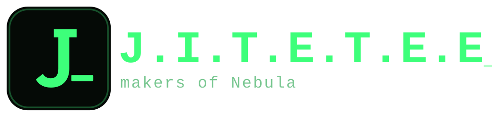
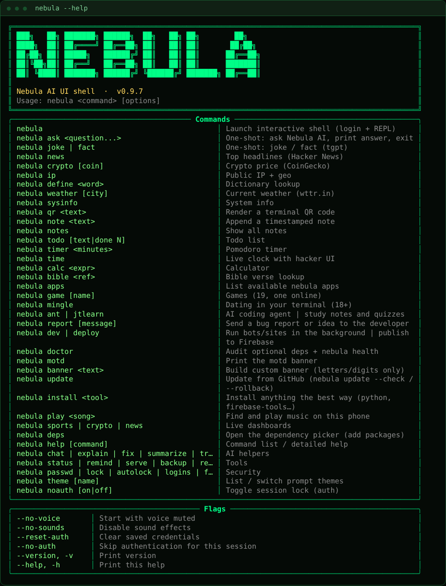
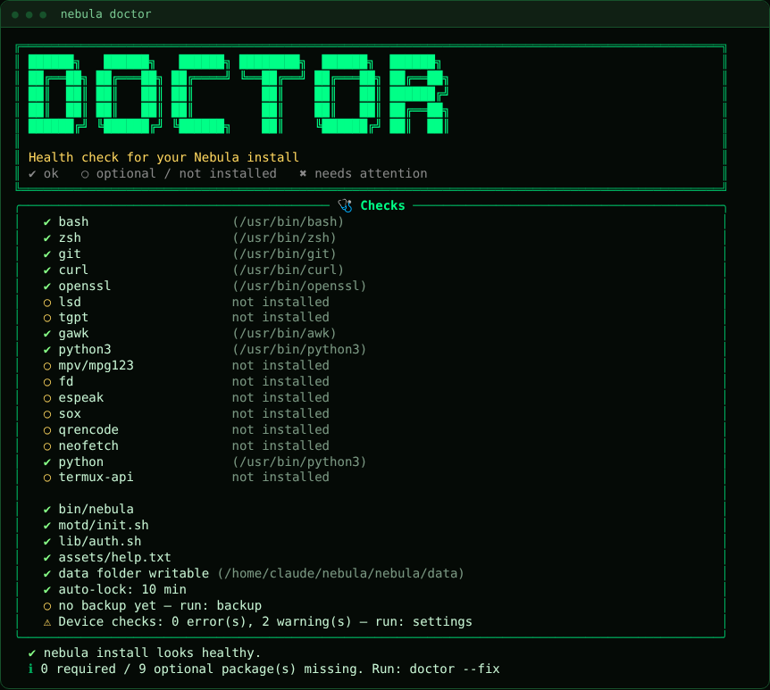
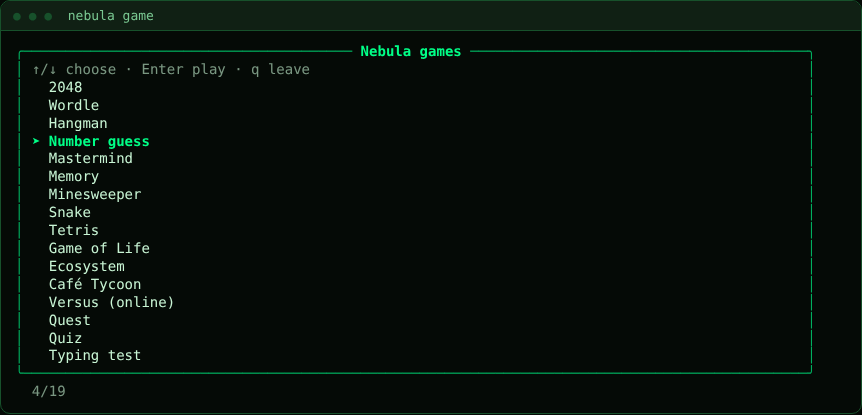
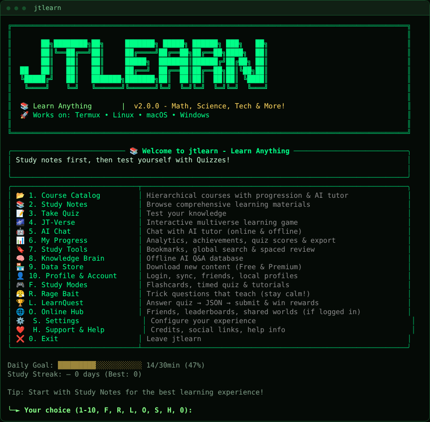
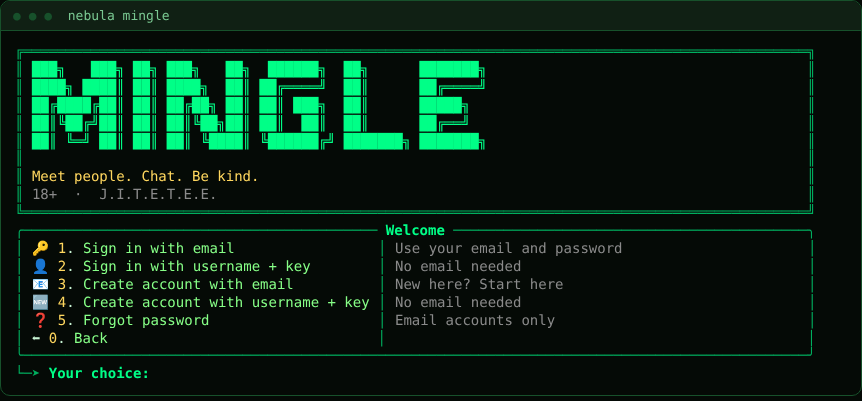
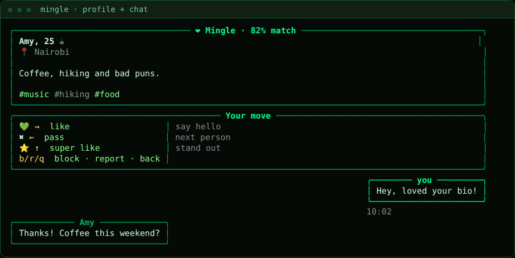
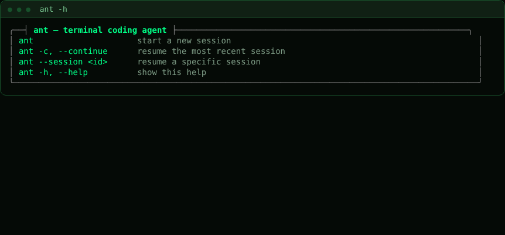
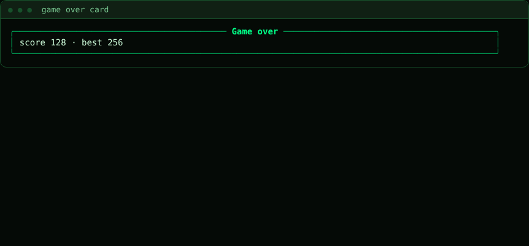

<div align="center">



# ⚡ Nebula

### The AI-powered terminal helper for Termux

[](docs/CHANGELOG.md)
[-3DDC84)](https://termux.dev)
[](LICENSE)

</div>

Nebula turns Termux into a friendlier terminal: an AI that formats its answers properly, one-command installs, live dashboards, a built-in fuzzy picker, a customizable home screen, and a local login lock. It adapts to your screen size and your phone's capabilities.

## Screenshots

| | |
|---|---|
|  |  |
|  |  |
|  |  |
|  |  |

The website (JIF Store, community, admin) is shown in [`docs/screenshots/`](docs/screenshots) too. Tests regenerate these every run (`tests/screenshots/`).

## JIF Store

`.jif` (JITETEE Import File) lessons are listed on the website's **JIF Store** and inside jtlearn (Data Store, menu 9). Browse, rate, download, or submit your own for admin approval. Database setup: [`docs/database.rules.json`](docs/database.rules.json) + the seed in the website project (`tools/make-seed.py`).

## Requirements

- [Termux](https://github.com/termux/termux-app/releases) from **F-Droid** or **GitHub**, Android 7+
- `curl` and `tar` (already in Termux), about 15 MB of space
- Optional: `zsh`, `git`, `gawk`, `tgpt`, and the **Termux:API** app (the installer offers these)

## Install

```bash
# one-liner
curl -fsSL https://raw.githubusercontent.com/jitetee/nebula/main/install/install.sh | bash

# or from a clone / ZIP
git clone https://github.com/jitetee/nebula.git && cd nebula && bash install/install.sh
```

Once the package repo is set up you can also use `pkg install nebula` (see [docs/PACKAGING.md](docs/PACKAGING.md)).

The installer shows an arrow-key package picker (nothing installs without your OK), copies Nebula to `$PREFIX/opt/nebula` (`chmod 700`), optionally applies the Termux font/colors/extra keys, appends a managed block to `~/.zshrc`, and links `nebula` into `$PREFIX/bin`.

```bash
bash install/install.sh --basic        # basic package set, no questions
bash install/install.sh --skip-deps    # Nebula only
bash install/install.sh --deps-only    # just the package picker
```

Restart Termux (or `exec zsh`) afterwards. On first launch you create a username and password; run `help` for everything or `help <command>` for examples.

## Features

**AI** (needs `tgpt`): `ask`, `chat`, `explain`, `fix`, `summarize`, `translate`, `joke`, `fact`. Answers render as styled terminal text (headings, lists, tables, boxed code), wrapped to your screen. `fix` explains your last failed command and never runs anything itself.

**Talk to Termux:** a missing command offers to install its package and then runs it; a plain-English sentence becomes a plan you approve (`[e]dit` first if you like). Risky commands (`rm -r`, `dd`, `sudo`, `curl | sh`…) are marked ⚠ and need you to type `yes`. `tell <request>` does it on purpose; `english ask|auto|off` sets how eager it is. In the Nebula shell, `!cmd` sends a line to Termux as typed and `?request` is plain English.

**`nebula install`:** picks the right method (pkg, pip, npm, cargo…), installs prerequisites, shows live progress, repairs common failures and falls back to another method.

```bash
nebula install python        nebula install list         nebula install info yt-dlp
nebula install yt-dlp -v     nebula install log          nebula uninstall cmatrix
```

**Dashboards** (need `curl`, `python3`): `crypto [coin] [--days 90] [--kes]`, `news [topic]`, `sports [league] [table|next]`, `weather [city]`. `status` (or `status --live`, `dash`) draws CPU, memory, storage, battery, network, temperature and top processes, laid out in 1–4 columns to fit the screen.

**`play`:** finds songs anywhere on the phone, tolerates typos (`play sumer vibs`, `--shuffle`, `--bg`, `--reindex`, `stop`). Needs `mpg123`, `sox` or `mpv`.

**Helpful typing:** ghost suggestions (accept with →) and a Tab picker that understands commands, folders, tool names, songs and files. No `fzf` needed.

**Make it yours:** `theme studio` (prompt designer with live preview; presets `nebula compact minimal forest sky hacker classic zen`), `home edit` / `home preset <name>` (startup screen), `profile use work` (switch voice, lock timer, prompt and home at once), `layout auto|phone|wide`.

**Device-aware:** `settings` scans your phone, explains what's wrong with one-key fixes, and hides commands your device can't run. Compact startup turns on automatically on low-RAM / 32-bit phones.

**Also:** `remind 10m call mom`, `todo` with priorities, `notes`, `serve` (share a folder with a QR code), `dev` (background bots/sites, error-only logs), `deploy` (Firebase), `game` (19 games, one online), `mingle` (dating, 18+), `ant` (AI coding agent), `jtlearn` (study notes, quizzes and the rage-bait game), `report` (send a bug report), `backup` / `restore`, `tour`, `doctor --fix`.

## Commands

`help` lists them live (`help --all` includes ones your device can't run; `help search <word>` finds one). In plain zsh, use the `nebula` prefix when a name clashes with a system command: `nebula install python`.

| Category | Commands |
| :-- | :-- |
| **AI** | `ask` `chat` `tell` `english` `explain` `fix` `summarize` `translate` `joke` `fact` |
| **Info** | `weather` `crypto` `news` `sports` `ip` `define` `bible` `meme` |
| **Tools** | `status` `dash` `remind` `timer` `note` `notes` `todo` `calc` `qr` `serve` `dev` `deploy` |
| **System** | `install` `uninstall` `deps` `update` `setup` `settings` `device` `scan` `doctor` `sysinfo` |
| **Media** | `play` |
| **Fun** | `game` `mingle` `ant` `jtlearn` |
| **Security** | `passwd` `lock` `autolock` `fingerprint` `logins` `noauth` `reset-auth` `whoami` |
| **Data** | `backup` `restore` |
| **Look** | `theme` `prompt` `home` `profile` `layout` `keys` `banner` `voice` `sounds` |

## Keyboard shortcuts

The Termux extra-keys row keeps 24 buttons; swipe one up for a second key (`^C`, `hist`, `dir`, `file`, `clr`, `KEYBOARD`, brackets…). `VOL+` `VOL-` `MUTE` control volume, with brightness and torch on swipe-up (need Termux:API). `keys` shows the cheat sheet and `keys reload` applies edits to `assets/termux.properties`.

| Key | Action |
| :-- | :-- |
| **→** / **Ctrl-F** / **End** | Accept the ghost suggestion (**Alt-F**: one word) |
| **Tab** | Context-aware picker (**Shift-Tab**: normal zsh completion) |
| **Ctrl-R** / **Ctrl-T** / **Alt-C** | Search history · pick a file · pick a folder and `cd` |

In the picker: type to filter · **↑/↓** move · **Enter**/**Tab** select · **Esc** cancel · **Ctrl-U** clear.

## Security

- App and data are `chmod 700`; the login is a salted PBKDF2 hash in a `0600` file.
- 3 wrong passwords at login, `lock`, `passwd` or any password confirmation **close the whole Termux session**. Failed attempts are logged (`logins`) and reported at your next login.
- Idle auto-lock (default 10 min: `autolock 5` / `autolock off`), optional `fingerprint on` (needs Termux:API), encrypted backups (`backup --encrypt`).
- Updates come from GitHub over HTTPS, are validated first, and keep your previous version for `nebula update --rollback`.

> This is a local convenience lock. Anyone with unrestricted access to your unlocked Termux can bypass it. Use your phone's screen lock for real protection.

## Where things live

Everything is in `$PREFIX/opt/nebula/` and survives updates in its `data/` folder (login hash, notes, todo, chats, backups, prompt/home settings, caches). Only a few files must stay in your home because Termux and zsh read them there: a marked `# nebula-BEGIN … # nebula-END` block in `~/.zshrc`, a few lines in `~/.bashrc`, links in `~/.termux/`, and the `nebula` link in `$PREFIX/bin`. Deleting any of them loses the hook, never your data.

## Update, turn things off, uninstall

```bash
nebula update [--check | --force | --rollback | --branch dev]
bash $PREFIX/opt/nebula/install/uninstall.sh [--purge-config]   # restores your original font/colors/keys
```

Forks or private repos: `export NEBULA_REPO=https://github.com/<you>/<repo>` (and `NEBULA_TOKEN` for private ones).

| I want to… | Do this |
| :-- | :-- |
| Mute voice / UI sounds | `voice off` / `sounds off` (or `NEBULA_VOICE=0`, `NEBULA_SOUNDS=0`) |
| Skip the login | `noauth on` (asks for your password) |
| Lighter startup / hide it | `settings → Features → Compact startup` / `home off` |
| Stop update notices | `export NEBULA_NO_UPDATE_CHECK=1` |
| Plain AI text | `export NEBULA_PLAIN_AI=1` |
| Turn off the Tab picker | `export NSH_SKIP_PICK=1` |
| Plain prompt | `theme reset` |

Put exports in `~/.zshrc.local`; Nebula never touches that file. Other variables: `NEBULA_BACKUP_DIR` (default `/sdcard/Nebula`), `NEBULA_MUSIC_DIRS`, `NEBULA_YES=1` (auto-confirm), `NEBULA_KEEP_SOURCE=1` (installer), `NSH_SKIP_AUTH=1`, `NEBULA_COLS`/`NEBULA_ROWS` (force a screen size).

## Termux:API without the Play Store

Termux:API is the `termux-api` package **and** the separate Android app, and both must come from the **same source** as Termux (F-Droid with F-Droid, GitHub with GitHub). Get the APK from [F-Droid](https://f-droid.org/packages/com.termux.api) or [GitHub](https://github.com/termux/termux-api/releases) (`arm64-v8a` for 64-bit phones, `armeabi-v7a` for `armv7l`). If your phone blocks APK installs, allow *Install unknown apps* for your file manager, or use `adb install`. Then `pkg install termux-api`, open the Termux:API app once, grant permissions, and run `settings → Re-scan`. Without it Nebula still works in no-API mode (no battery/fingerprint, reminders show in the terminal).

## Troubleshooting

Start with `nebula doctor` (add `--fix`), `nebula settings` or `nebula device`, and `nebula install log`.

| Problem | Fix |
| :-- | :-- |
| `nebula: command not found` | `ln -sf $PREFIX/opt/nebula/bin/nebula $PREFIX/bin/nebula`, or re-run the installer |
| Doesn't start with Termux | `pkg install zsh`, then re-run the installer to restore the `.zshrc` block |
| Forgot my password | `nebula --reset-auth` from an unlocked shell, or `restore` a backup |
| Session closed on its own | 3 wrong passwords (by design); see `logins` |
| Locked out, session keeps closing | Quickly run `nebula --reset-auth`, or start `bash --norc` first |
| Battery / fingerprint missing | Termux:API isn't set up (see above) |
| Reminders don't fire in sleep | *Settings → Apps → Termux → Battery → Unrestricted*, and `termux-wake-lock` |
| `backup` can't reach shared storage | `termux-setup-storage` |
| `ask` / `chat` unavailable | `nebula install tgpt`, check your connection |
| `crypto` / `sports` rate-limit | CoinGecko's free tier: wait a minute |
| `play` finds nothing or has no player | `play --reindex`; `nebula install mpg123` (or `sox`, `mpv`) |
| `install` fails | `nebula install <tool> -v`, `nebula install log`, try `pkg update` or free up storage |
| Tab picker missing | `NSH_SKIP_PICK=1` is set, or you're not in zsh |
| Broken icons/fonts | Restart Termux, or uninstall to restore your own font |
| Layout looks wrong | `layout phone` (one column) or `layout wide`; smaller font gives more columns; `theme compact` suits narrow prompts |
| An update broke something | `nebula update --rollback` |

Still stuck? Open an issue at <https://github.com/jitetee/nebula/issues> with the output of `nebula --version`, `nebula device` and `nebula doctor`.

## Contributing

See [docs/ARCHITECTURE.md](docs/ARCHITECTURE.md). Quick reference:

- **Add a tool to `nebula install`:** one line in `assets/registry.txt`: `name|aliases|method:target;method:target|Category|Description` (join packages with `+`).
- **Add a league:** one line in `assets/leagues.txt` (`key|Name|sport|espn/path|aliases`).
- **Add a command:** define `cmd::yourcommand` in `lib/` and add a block to `assets/help.txt`; help, completion and "did you mean" pick it up.
- Check scripts with `bash -n` and `zsh -n`, and test layouts at about 30–45 columns (`NEBULA_COLS=36 nebula status`).
- **Release:** bump `VERSION`, add a section to `docs/CHANGELOG.md`, push to `main`.

## Credits & license

Based on **cvui** by cybervaultke (MIT). Thanks to the Termux team, CoinGecko, the BBC and Hacker News feeds, and ESPN's public scoreboards. Released under the [MIT License](LICENSE).
